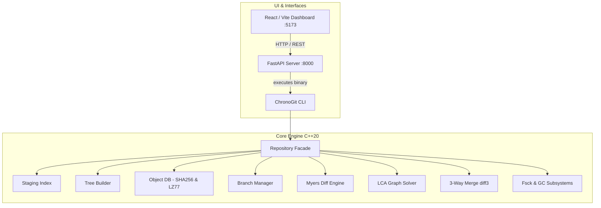

# ChronoGit — Lightweight Version Control Engine

ChronoGit is a local version-control engine built from scratch in modern **C++20**. It implements Git internals—content-addressable object storage, directed acyclic commit graphs, branch heads, line-level diffing, three-way conflict reconciliation, repository integrity checks, and mark-and-sweep garbage collection—without calling or shelling out to Git.

---

## Key Features

- **Content-Addressable Storage (CAS)**:
  - Objects addressed by cryptographically secure **SHA-256** hashes.
  - Automatic deduplication of identical file contents across files, directories, and branches.
  - Built-in **LZ77** compression reducing disk footprint by >84%.
  - Sharded object storage (`.chronogit/objects/ab/cdef...`) for filesystem performance.
- **Hierarchical Tree & Snapshot System**:
  - `Blob`: Raw file contents.
  - `Tree`: Hierarchical directory tree entries (`[mode] [type] [hash] [name]`).
  - `Commit`: Snapshot pointer with author signature, timestamp, parent references, and message.
- **Branch Management & Detached HEAD**:
  - Branch heads tracked in `.chronogit/refs/heads/<branch>`.
  - Safe branch switching preventing accidental overwriting of uncommitted local work.
  - Support for detached HEAD commit inspection.
- **Myers Diff Engine**:
  - Implementation of Eugene Myers' $O(ND)$ difference algorithm.
  - Line-level differences with unified hunk format (`@@ -l,s +l,s @@`) and ANSI colorization.
  - Tree-to-tree and workdir-to-index diffs.
- **Three-Way Merge Engine**:
  - Lowest Common Ancestor (LCA) search in DAG via Breadth-First Search (BFS).
  - Fast-forward merge detection when ancestor matches current branch.
  - Line-level `diff3` reconciliation with automatic clean merging of non-overlapping edits.
  - Clear conflict markers (`<<<<<<< HEAD`, `=======`, `>>>>>>>`) for overlapping changes.
- **Data Integrity & Garbage Collection**:
  - `chronogit fsck`: Verifies object checksums, ref integrity, and detects bit flips.
  - `chronogit gc`: Mark-and-sweep reachability analysis with `--dry-run` safety mode.
  - Atomic file replacement (`MoveFileExW` / `rename`) protecting against partial writes.
- **Full Interactive Web Dashboard**:
  - React + TypeScript web visualizer with interactive DAG graph, staging panel, branch manager, diff viewer, merge studio, and benchmark explorer.

---

## Architecture Diagram



---

## Quick Start: Building & Running

### Prerequisites
- C++20 compiler: Clang++ (16+), GCC (11+), or MSVC (2019+)
- CMake 3.20+
- Ninja or Make
- Python 3.8+ (for local API backend and dev server)

### 1. Build the C++ Engine, Tests & Benchmarks
```powershell
# Configure CMake with Ninja
cmake -B build -G Ninja -DCMAKE_CXX_COMPILER=clang++

# Compile the library, CLI executable, test suite, and benchmark suite
cmake --build build
```

This produces:
- `build/chronogit.exe`: The standalone version-control CLI.
- `build/tests/chronogit_tests.exe`: The automated unit and integration test suite.
- `build/benchmarks/chronogit_benchmark.exe`: The performance evaluation harness.

---

## 2. Local Development & Interactive Web UI

You can inspect and test the complete application interface locally before deploying anywhere:

```powershell
# Single convenient startup command:
python start_dev.py
```
*(On Windows, you can also double-click `start_dev.bat`)*

This starts:
1. **FastAPI Backend**: `http://localhost:8000` (API documentation at `http://localhost:8000/docs`)
2. **Frontend Dev Server**: `http://localhost:5173` (Connected to the running backend)

### Features in the Web Dashboard:
- **🔀 Commit DAG Explorer**: Visual interactive nodes, branch lanes, merge commits, clickable details.
- **📝 Staging & Worktree Panel**: Live status, stage/unstage files, commit message input, create/edit files.
- **🌿 Branch Manager**: Switch branches, create branches, delete branches.
- **🔍 Diff Viewer**: View syntax-highlighted line differences (staged vs unstaged).
- **⚡ 3-Way Merge Studio**: Merge branches, detect conflicts, inspect conflict markers.
- **🛡️ Integrity Dashboard**: Run `fsck` integrity checks and `gc` garbage collection.
- **📊 Performance Benchmark Viewer**: Interactive graphs and tables of actual measured results.

---

## 3. CLI Command Guide

```bash
# Initialize repository in current directory
chronogit init

# Stage files into index
chronogit add README.md src/main.cpp
chronogit add .

# Record snapshot commit
chronogit commit -m "feat: implement content addressable storage"

# Check working tree status
chronogit status

# Inspect commit DAG history
chronogit log
chronogit log --oneline --graph
chronogit log -n 5 --stat

# Branch management
chronogit branch                    # List branches
chronogit branch feature/auth       # Create branch
chronogit branch -d feature/auth    # Delete branch

# Switch branches or checkout commits
chronogit checkout feature/auth
chronogit checkout -b feature/ui    # Create and checkout
chronogit checkout <commit_hash>    # Detached HEAD inspection

# Inspect differences
chronogit diff                      # Unstaged changes (workdir vs index)
chronogit diff --staged             # Staged changes (index vs HEAD)
chronogit diff <commit1> <commit2>  # Commit vs commit diff

# Three-way merge
chronogit merge feature/auth
chronogit merge --abort             # Abort conflicting merge

# Object inspection
chronogit show                      # Show HEAD commit and patch
chronogit show <object_id>          # Inspect specific commit, tree, or blob

# Integrity and Garbage Collection
chronogit fsck                      # Verify object hashes and connectivity
chronogit gc --dry-run              # Estimate unreachable space
chronogit gc                        # Purge unreachable objects
```

---

## 4. Automated Testing

Run the test suite:
```powershell
.\build\tests\chronogit_tests.exe
```

Test coverage includes:
- **SHA-256 Hashing**: NIST standard test vectors, empty strings, streaming updates, determinism.
- **Lossless LZ77 Compression**: Roundtrips on text, empty data, binary data, bounds-checked corruption rejection.
- **Object Database (CAS)**: Blob, Tree, and Commit serialization; SHA-256 addressing; disk deduplication.
- **Index Staging**: Adding, updating, removing entries; stat comparison; atomic file persistence.
- **Tree Builder**: Nested directory hierarchy to subtrees; tree flattening; identical tree reuse.
- **Branch Manager**: Branch creation, listing, deletion, symbolic HEAD, detached HEAD.
- **Myers Diff**: Line additions, deletions, modifications, unified hunk headers (`@@ -l,s +l,s @@`).
- **Three-Way Merge**: Lowest Common Ancestor (LCA) in branching DAGs, fast-forward merges, clean 3-way merges, conflicting edits with markers.
- **Integrity (`fsck`) & GC**: Bit-flip corruption detection, dangling object identification, mark-and-sweep unreachable object deletion.
- **Full Integration Lifecycle**: End-to-end repository creation, multi-branching, committing, merging, conflict detection, resolution, and log history.

---

## 5. Performance Evaluation & Benchmark Results

Run the benchmark suite:
```powershell
.\build\benchmarks\chronogit_benchmark.exe
```

### Actual Benchmark Measurements (Windows x86_64, NVMe SSD)

#### Latency Across Scales:
| Files | Initial Snapshot | Incremental Commit (10%) | Myers Diff | Branch Checkout | Three-Way Merge | DAG History Walk |
|:---:|:---:|:---:|:---:|:---:|:---:|:---:|
| **100** | 268 ms | 57 ms | 8 ms | 137 ms | 161 ms | 5.1 ms |
| **500** | 1,057 ms | 215 ms | 21 ms | 917 ms | 953 ms | 3.9 ms |
| **1,000** | 2,047 ms | 430 ms | 30 ms | 1,531 ms | 1,693 ms | 5.9 ms |

#### Storage Deduplication & Compression Savings:
| Files | Naive Full-Copy (3 Commits) | ChronoGit CAS (Compressed) | Total Space Saved |
|:---:|:---:|:---:|:---:|
| **100** | 352.5 KiB | 63.0 KiB | **82.1% saved** |
| **500** | 1.7 MiB | 282.0 KiB | **84.2% saved** |
| **1,000** | 3.5 MiB | 561.8 KiB | **84.5% saved** |

---

## 6. Supported Diff & Merge Cases / Limitations

ChronoGit is designed as a lightweight, clean version control engine. To maintain educational clarity and simplicity:
- **Supported Diff Cases**:
  - Line-by-line Myers diff for UTF-8 and ASCII files.
  - File additions, modifications, and deletions.
  - Binary file detection (reports binary difference without corruption).
- **Supported Merge Cases**:
  - Fast-forward branch pointer advances.
  - Clean three-way merges when edits occur on non-overlapping lines.
  - Three-way conflict marking with standard delimiters (`<<<<<<<`, `=======`, `>>>>>>>`).
  - Add/add, edit/edit, and modify/delete conflict detection.
- **Known Limitations vs Full Git**:
  - Does not implement Git packfiles (`.pack` / `.idx`); uses individual compressed loose objects.
  - Does not implement remote networking protocols (e.g. `git push`, `git fetch` over SSH/HTTPS).
  - Renames are treated as deletion of old path and addition of new path (heuristic similarity rename detection is omitted).

---

## 7. Troubleshooting

- **Socket / Port Conflict**: If port 8000 or 5173 is in use by another application, kill the existing process or adjust the port in `server/app.py` and `web-visualizer/dev_server.py`.
- **Compiler Missing C++20**: Ensure your compiler supports C++20 (`std::span`, `std::filesystem`, concepts). Use Clang 16+ or GCC 11+.
- **Uncommitted Changes during Checkout**: If `chronogit checkout` refuses to switch branches, commit your working files or discard them before switching.
