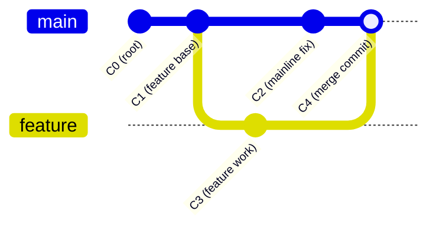
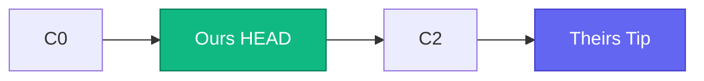
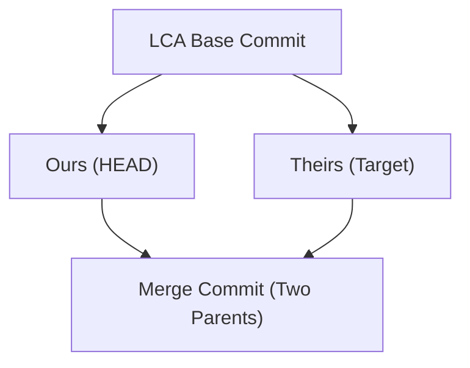

# ChronoGit — Commit DAG & Three-Way Merge Engine

This document details the graph structure of ChronoGit's commit history, the Lowest Common Ancestor (LCA) search algorithm, fast-forward branch advances, and the line-level three-way reconciliation algorithm (`diff3`).

---

## 1. Commit Directed Acyclic Graph (DAG)

In ChronoGit, commits form a Directed Acyclic Graph (DAG) where each commit points backwards to its parent(s).



### Properties:
1. **Acyclicity**: Because each commit points backwards to parents that existed before it was created, cycles are mathematically impossible.
2. **Immutability**: A commit's hash includes its parents' hashes. Modifying any historical commit alters its hash, all child commits, and all descendants.
3. **Branch Pointers**: Branches are named mutable pointers stored in `.chronogit/refs/heads/<name>` that store the 64-character hash of the branch's tip commit.

---

## 2. Lowest Common Ancestor (LCA) Algorithm

To merge branch `theirs` into branch `ours`, ChronoGit must find their closest common ancestor in the DAG.

### Algorithm:
1. **Ancestry & Distance Search from Ours**:
   - Starting from `commit_ours`, perform a Breadth-First Search (BFS) following `parent_ids`.
   - Maintain a map `dist_ours[commit_id] = distance_from_ours`.
2. **Intersection Search from Theirs**:
   - Starting from `commit_theirs`, perform BFS following `parent_ids`.
   - Maintain a map `dist_theirs[commit_id] = distance_from_theirs`.
   - When a commit $A$ is encountered that is present in `dist_ours`:
     - Calculate total graph path distance: $\text{distance} = \text{dist\_ours}[A] + \text{dist\_theirs}[A]$.
     - The candidate with the minimum total distance is selected as the Lowest Common Ancestor ($\text{LCA}$).

---

## 3. Merge Strategies

### 3.1 Already Up-to-Date
If $\text{LCA} == \text{commit\_theirs}$, the current branch already incorporates all commits from the target branch. No changes are applied.

### 3.2 Fast-Forward Merge
If $\text{LCA} == \text{commit\_ours}$, the target branch is a direct descendant of the current branch:

- No merge commit is needed.
- ChronoGit advances the branch pointer directly to `commit_theirs`.
- Working tree and index are updated to match `commit_theirs`.

### 3.3 Three-Way Merge
When histories have diverged ($\text{LCA} \ne \text{Ours}$ and $\text{LCA} \ne \text{Theirs}$):



Let:
- $B$ = File content in Base (LCA commit)
- $O$ = File content in Ours (HEAD commit)
- $T$ = File content in Theirs (Target branch commit)

#### Tree Level Resolution Matrix:
| In Base? | In Ours? | In Theirs? | Status / Action |
|:---:|:---:|:---:|---|
| Yes | Yes ($O = B$) | Yes ($T \ne B$) | Only Theirs changed $\to$ Accept $T$ (Clean) |
| Yes | Yes ($O \ne B$) | Yes ($T = B$) | Only Ours changed $\to$ Keep $O$ (Clean) |
| Yes | Yes ($O = T$) | Yes ($O = T$) | Both made identical changes $\to$ Accept $O$ (Clean) |
| Yes | Yes ($O \ne T$) | Yes ($O \ne T$) | Both changed differently $\to$ Line-level 3-way merge |
| Yes | Yes ($O = B$) | No | Deleted in Theirs, unchanged in Ours $\to$ Delete (Clean) |
| Yes | Yes ($O \ne B$) | No | Modified in Ours, deleted in Theirs $\to$ **CONFLICT** |
| Yes | No | Yes ($T = B$) | Deleted in Ours, unchanged in Theirs $\to$ Delete (Clean) |
| Yes | No | Yes ($T \ne B$) | Deleted in Ours, modified in Theirs $\to$ **CONFLICT** |
| No | Yes | No | Added in Ours only $\to$ Keep $O$ (Clean) |
| No | No | Yes | Added in Theirs only $\to$ Add $T$ (Clean) |
| No | Yes | Yes ($O = T$) | Added identically on both $\to$ Accept $O$ (Clean) |
| No | Yes | Yes ($O \ne T$) | Added differently on both $\to$ **CONFLICT** |

---

## 4. Line-Level Three-Way Reconciliation (`diff3`)

When both sides modified a file differently from Base:
1. Diff $(B \to O)$ is computed using Myers diff to generate edit intervals $[start_O, end_O)$ on base lines with replacement lines $R_O$.
2. Diff $(B \to T)$ is computed using Myers diff to generate edit intervals $[start_T, end_T)$ on base lines with replacement lines $R_T$.
3. We walk linearly along the base lines:
   - **Disjoint Edits**: If an edit in Ours does not overlap with any edit in Theirs, it is applied directly.
   - **Overlapping Identical Edits**: If both sides replaced the same lines with identical content, the replacement is accepted cleanly.
   - **Overlapping Conflicting Edits**: If both sides modified the same region differently, conflict markers are emitted:
     ```
     <<<<<<< HEAD
     [Lines from Ours]
     =======
     [Lines from Theirs]
     >>>>>>> [Target Branch Name]
     ```
4. If any file has conflicts:
   - Conflicting files are written to the working tree.
   - The merge target commit is written to `.chronogit/MERGE_HEAD`.
   - The user is notified to resolve conflicts and run `chronogit commit`.
5. If all files merged cleanly:
   - A merge commit with two parents (`parent1 = HEAD`, `parent2 = target_commit`) is automatically recorded.
