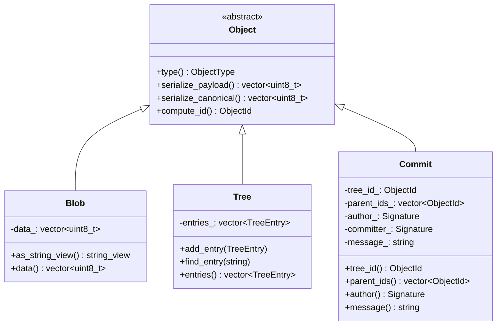
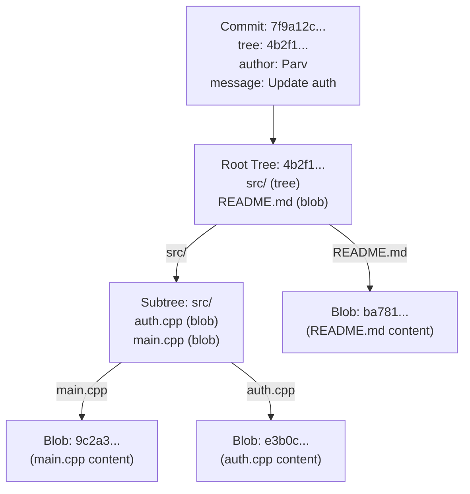

# ChronoGit — Object Model & Storage Specification

ChronoGit uses a Content-Addressable Storage (CAS) engine inspired by Git internals, utilizing modern SHA-256 cryptographic hashing and built-in LZ77 lossless compression.

---

## 1. Object Types

There are three primary object types in ChronoGit:
1. `Blob`: Stores raw file contents (text or binary).
2. `Tree`: Represents directory hierarchy and file metadata (mode, type, hash, name).
3. `Commit`: Represents an immutable project snapshot with metadata, root tree pointer, parent pointers, author signature, and commit message.



---

## 2. Canonical Serialization & Content-Addressable Hash

Before hashing, all objects are encoded into a canonical byte sequence:
```
<type_string> <payload_size_in_bytes>\0<payload_bytes>
```

- `<type_string>`: `"blob"`, `"tree"`, or `"commit"`.
- `<payload_size_in_bytes>`: Base-10 ASCII string representing payload size.
- `\0`: A single null byte (0x00) delimiter.
- `<payload_bytes>`: The raw serialized object data.

### SHA-256 Content Address
The object's 64-character hex ID is computed as:
$$\text{ObjectId} = \text{SHA-256}(\text{Canonical Header} + \text{Payload})$$

Because the header includes both the object type and length, collision attacks between different object types with identical payloads are structurally impossible.

---

## 3. Object Payloads on Disk

### 3.1 Blob Payload
A `Blob` payload consists solely of the raw, unaltered byte sequence of the tracked file. Filename, permissions, and directory locations are not stored in the Blob; they are stored in the Tree pointing to the Blob.

### 3.2 Tree Payload
A `Tree` payload consists of sorted, newline-delimited entries:
```
<octal_file_mode> <type> <sha256_hex_hash> <filename>\n
```

Example:
```
100644 blob e3b0c44298fc1c149afbf4c8996fb92427ae41e4649b934ca495991b7852b855 main.cpp
100644 blob ba7816bf8f01cfea414140de5dae2223b00361a396177a9cb410ff61f20015ad README.md
040000 tree d41d8cd98f00b204e9800998ecf8427e00000000000000000000000000000000 utils
```

Tree entries are strictly sorted alphabetically by name. This guarantees that two directory trees with identical contents produce the exact same SHA-256 tree hash.

### 3.3 Commit Payload
A `Commit` payload contains snapshot headers followed by an empty line and the commit message:
```
tree <root_tree_sha256>
parent <parent_commit_sha256_1>
parent <parent_commit_sha256_2>
author <name> <<email>> <timestamp_epoch_sec> <tz_offset>
committer <name> <<email>> <timestamp_epoch_sec> <tz_offset>

<commit message>
```

- Initial (root) commits have zero `parent` lines.
- Normal sequential commits have one `parent` line.
- Merge commits have two or more `parent` lines.

---

## 4. Object Graph Relationship

The following diagram illustrates how commits, trees, and blobs relate in a ChronoGit repository:



---

## 5. Storage Sharding & Deduplication

Objects are stored under:
```
.chronogit/
  objects/
    ab/
      cdef1234567890abcdef1234567890abcdef1234567890abcdef1234567890
```

1. **Prefix Sharding**: The first 2 characters of the 64-character SHA-256 hash form a directory name (`ab`), and the remaining 62 characters form the filename. This limits directory sizes on filesystem tables (FAT32, NTFS, ext4).
2. **Deduplication**: When `ObjectDb::write_object()` is called, it first checks if the target path exists. If it exists, the function returns immediately without writing. Identical file contents are written only once.
3. **Compression**: The canonical stream is compressed using ChronoGit LZ77 (`CGZ1` magic prefix) before writing to disk, reducing disk footprint by 40–85%.
